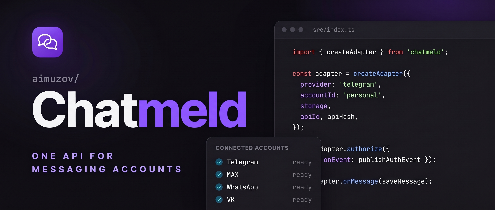

<p align="center">
	
	<a href="https://github.com/aimuzov/chatmeld/blob/main/README.ru.md"></a>
</p>

<p align="center">
  
</p>

<p align="center">
  <a href="https://github.com/aimuzov/chatmeld/actions/workflows/check.yml"></a>
  <a href="https://github.com/aimuzov/chatmeld/blob/main/package.json"></a>
  <a href="https://github.com/aimuzov/chatmeld/blob/main/src/index.ts"></a>
  <a href="https://www.npmjs.com/package/@aimuzov/chatmeld"></a>
  <a href="https://github.com/aimuzov/chatmeld/releases"></a>
  
</p>

<h3 align="center">One API for personal messaging accounts</h3>

# Chatmeld

One TypeScript API for personal Telegram, MAX, WhatsApp, VK and Instagram accounts. Connect accounts to your backend, authorize with QR codes, list chats, send text and receive incoming messages.

Your project supplies users, UI, HTTP routes, message persistence and session storage. Chatmeld runs the connections; it has no database or HTTP server of its own.

## Install

Requires Node.js >=24. The package ships compiled ESM and TypeScript declarations; consumers do not need `tsx`.

```sh
npm install -E @aimuzov/chatmeld
```

### Provider options

Every provider requires `accountId: string` and `storage: SessionStorage`. Your application assigns `accountId`; it is neither a token nor the provider user ID.

| `provider`    | Additional options                                    | Runtime                               |
| ------------- | ----------------------------------------------------- | ------------------------------------- |
| `"telegram"`  | Your application's `apiId: number`, `apiHash: string` | Node.js                               |
| `"max"`       | `pythonCommand?: string` interpreter path             | Python >=3.12, `maxapi-python==2.5.0` |
| `"whatsapp"`  | None                                                  | Node.js                               |
| `"vk"`        | None                                                  | Playwright Chromium                   |
| `"instagram"` | `username: string`, `pythonCommand?: string`          | Python >=3.12, `instagrapi==3.2.2`    |

For VK, install Chromium on the application server:

```sh
npm exec playwright install chromium
```

VK uses an isolated headless browser for authorization and closes it on success, failure or cancellation. Messaging uses the API. MAX starts a separate Python process; pass an interpreter with the dependency installed. The package includes `python/pyproject.toml` and `python/uv.lock`.

## Quickstart

Save the implementation under "Session storage" as `sqlite-storage.ts` and this example as `app.ts`. Compile with TypeScript NodeNext/ESM and run the resulting `app.js`. It restores a session, prints chats and closes the connection. For first login, use the authorization flow below.

```ts
import { AdapterError, createAdapter } from "@aimuzov/chatmeld";
import { DatabaseSync } from "node:sqlite";
import { sqliteSessionStorage } from "./sqlite-storage.js";

const db = new DatabaseSync("sessions.sqlite");
const userId = "user-42";
const accountId = "main";
const provider = "whatsapp";
const storage = sqliteSessionStorage(
  db,
  JSON.stringify([userId, provider, accountId]),
);
const adapter = createAdapter({ provider, accountId, storage });

const removeState = adapter.onState((state) => {
  if (state.state === "error") console.error(state.error);
});
const removeMessages = adapter.onMessage(async (message) => {
  console.log(JSON.stringify(message));
});

try {
  await adapter.connect();
  const chats = await adapter.listChats();
  console.log(chats);
} catch (error) {
  if (error instanceof AdapterError && error.code === "AUTH_REQUIRED") {
    console.log("Start authorization from your application");
  } else {
    throw error;
  }
} finally {
  await adapter.disconnect();
  removeMessages();
  removeState();
  db.close();
}
```

```sh
npm pkg set type=module
npm install -D -E typescript @types/node
npx tsc app.ts sqlite-storage.ts --module nodenext --target es2022 --types node --outDir dist
node dist/app.js
```

For continuous delivery, keep the instance connected until service shutdown. Replace `console.log` in the handler with a committed write to your database.

## QR, challenges and connection ownership

This is application-layer code, not HTTP routes. `storageFor` returns persistent storage for the user and account; `sendToUser` forwards events to that user's client through your transport. Derive `userId` from your authenticated server session and check ownership of `accountId` on every request.

```ts
import type {
  AuthEvent,
  MessagingAdapter,
  SessionStorage,
} from "@aimuzov/chatmeld";
import { createAdapter } from "@aimuzov/chatmeld";

declare function storageFor(userId: string, accountId: string): SessionStorage;
declare function sendToUser(userId: string, event: AuthEvent): Promise<void>;

const connections = new Map<
  string,
  {
    adapter: MessagingAdapter;
    stop: AbortController;
  }
>();

function connectionKey(userId: string, accountId: string) {
  return JSON.stringify([userId, "vk", accountId]);
}

export async function authorize(userId: string, accountId: string) {
  const key = connectionKey(userId, accountId);
  if (connections.has(key)) throw new Error("Connection already active");
  const adapter = createAdapter({
    provider: "vk",
    accountId,
    storage: storageFor(userId, accountId),
  });
  const stop = new AbortController();
  connections.set(key, { adapter, stop });
  try {
    await adapter.authorize({
      signal: stop.signal,
      onEvent: (event) => sendToUser(userId, event),
    });
    return adapter;
  } catch (error) {
    await adapter.disconnect();
    if (connections.get(key)?.adapter === adapter) connections.delete(key);
    throw error;
  }
}

export function respond(
  userId: string,
  accountId: string,
  response: { challengeId: string; value: string },
) {
  const connection = connections.get(connectionKey(userId, accountId));
  if (!connection) throw new Error("Connection not found");
  connection.adapter.respondToChallenge(response);
}

export async function close(userId: string, accountId: string) {
  const key = connectionKey(userId, accountId);
  const connection = connections.get(key);
  if (!connection) return;
  connection.stop.abort();
  await connection.adapter.disconnect();
  if (connections.get(key)?.adapter === connection.adapter)
    connections.delete(key);
}
```

The first request starts `authorize()`. The client receives `qr`, renders an image from `value` and replaces it on each new event. For `challenge`, show `prompt` and submit the received `challengeId` with the user's `value` in a second request that calls `respond()`.

Both requests must reach the same backend process and adapter instance. Do not create a new adapter for the response. Successful `authorize()` leaves the connection active; use the returned adapter for chats, sending and subscriptions. Call `close()` separately when that account's connection should end.

| Event       | Fields                                                                    |
| ----------- | ------------------------------------------------------------------------- |
| `qr`        | `value: string`, optional `expiresAt: string`                             |
| `challenge` | `challengeId`, `kind: "code" \| "password"`, `prompt`, optional `pattern` |
| `progress`  | `message: string`                                                         |

Authorization has a three-minute limit. `AbortSignal` cancels it; login succeeds only when its promise resolves after session writes. VK codes and Telegram 2FA passwords use the same challenge API. Send QR payloads, responses and passwords only to the owner and keep them out of logs. Events contain no saved session tokens.

The `connections` map lives in process memory. Restarting loses instances and pending challenges, while persisted sessions remain. Restore connections with `connect()` and restart unfinished authorization. In production, add lifecycle management, routing to the connection owner and cleanup when an account's work ends.

## API

| API                                          | Result and behavior                                                                                                                                                      |
| -------------------------------------------- | ------------------------------------------------------------------------------------------------------------------------------------------------------------------------ |
| `createAdapter(options)`                     | Returns `MessagingAdapter`; validates options synchronously. No connection starts yet.                                                                                   |
| `adapter.provider`, `adapter.accountId`      | Read-only provider and consumer-assigned account identity.                                                                                                               |
| `connect({ signal? }?)`                      | `Promise<void>`; restores a saved session, without starting interactive login.                                                                                           |
| `authorize({ onEvent, signal? })`            | `Promise<void>`; QR login, optional challenges, then committed session and connected state.                                                                              |
| `respondToChallenge({ challengeId, value })` | `void`; submits a response to a currently pending challenge on this instance; can throw synchronously.                                                                   |
| `listChats()`                                | `Promise<Chat[]>`; each chat has string `id` and `title`. Requires connection.                                                                                           |
| `getAvatar({ type, id })`                    | `Promise<Avatar \| undefined>`; chat or user photo as bytes and MIME type.                                                                                               |
| `sendMedia(chatId, media)`                   | `Promise<{ externalId: string }>`; photo, video or audio, up to 20 MiB.                                                                                                  |
| `downloadMedia(reference)`                   | `Promise<MediaFile>`; server-side attachment reference, up to 20 MiB.                                                                                                    |
| `listMessages?(chatId, { limit? }?)`         | `Promise<Message[]>`; recent Telegram/VK/Instagram messages, newest first. Default limit 100; valid integers 1..100. Returns `[]` for WhatsApp/MAX. Requires connection. |
| `sendMessage(chatId, text)`                  | `Promise<{ externalId: string }>`; sends non-empty text to a string chat ID. Requires connection.                                                                        |
| `onMessage(handler)`                         | Subscribes to incoming messages; handler returns `void` or `Promise<void>`. Returns unsubscribe function.                                                                |
| `onState(handler)`                           | Subscribes to future state changes; synchronous handler. Returns unsubscribe function.                                                                                   |
| `disconnect()`                               | `Promise<void>`; closes resources and flushes session writes, keeping saved credentials.                                                                                 |

Do not overlap `connect()`/`authorize()` calls on one instance. Await `disconnect()` before starting again. Disconnecting during login cancels it; repeated shutdown calls are safe. Shutdown keeps the session and does not close your database.

States are `connecting`, `authorizing`, `connected`, `disconnected` and `error`. The `AdapterState` type also permits `idle`; subscriptions report future changes without an immediate snapshot. The error state carries `error`. State handlers are synchronous: do not pass an async function.

Subscribe before connecting. Messages are not buffered without subscribers. Async message handlers run serially; the queue holds at most 100 messages, including the one being processed. Handler failure or overflow closes the connection with `HANDLER_ERROR` or `QUEUE_OVERFLOW`. Add your own queue and committed persistence where needed.

## Chats and messages

After `connect()` or `authorize()` resolves, select a chat and send text. Here `selectedChatId` comes from your client and `persistOutgoing` saves the send result in your database.

```ts
const chats = await adapter.listChats();
const chat = chats.find((item) => item.id === selectedChatId);
if (!chat) throw new Error("Chat not found");
const sent = await adapter.sendMessage(chat.id, "Hello!");
await persistOutgoing({
  provider: adapter.provider,
  accountId: adapter.accountId,
  chatId: chat.id,
  messageId: sent.externalId,
  text: "Hello!",
});
```

Subscriptions deliver incoming messages. Render and persist your outgoing message from the `sendMessage()` result and its `externalId`; do not wait for an outgoing echo in `onMessage`.

Example `Message`:

```json
{
  "provider": "whatsapp",
  "accountId": "main",
  "chatId": "120363000000000000@g.us",
  "messageId": "ABC123",
  "senderId": "15551234567@s.whatsapp.net",
  "displayName": "Alice",
  "direction": "incoming",
  "text": "Hello!",
  "sentAt": "2026-11-03T10:00:00.000Z",
  "attachments": []
}
```

All IDs are strings. `senderId`, `displayName` and `username` are optional; `direction` is typed as `"incoming" | "outgoing"`. `sentAt` is a timestamp string. `attachments` is an array of `{ kind: string }`, without file contents. Deduplicate by provider, account, chat and message ID.

### Recent messages

Telegram, VK and Instagram return recent messages, newest first. `listMessages` is optional in the public interface: use optional chaining for implementations without it. An empty array for WhatsApp/MAX does not mean the account has no history; those providers deliver incoming messages after connection.

```ts
const recent =
  (await adapter.listMessages?.(selectedChatId, { limit: 50 })) ?? [];
for (const message of recent) {
  await persistIncoming(message);
}
```

`persistIncoming` here stores a message in your database; respect `direction`, since history includes outgoing messages. Your project keeps durable history. There is no full synchronization, pagination or guaranteed gap recovery.

## Instagram

Install Python >=3.12 with `instagrapi==3.2.2` and pass that interpreter as `pythonCommand`. In the repository, `npm run setup:instagram` creates the environment with the optional Instagram dependency.

Username is an Instagram handle without `@`. Use user-scoped `storage` from your application. Password and optional verification codes go through the existing `authorize()` / `respondToChallenge()` flow. QR login is not implemented for Instagram. Passwords are not saved in the session.

```ts
const instagram = createAdapter({
  provider: "instagram",
  accountId: "personal",
  username: "your_username",
  pythonCommand: "/app/.venv/bin/python",
  storage,
});
```

Instagram uses an unofficial API. Some security checkpoints require confirmation in the official application and another login attempt. Incoming messages are polled every 15 seconds from the last 20 dialogs, up to 20 messages per dialog. This is best effort; it does not recover every gap under a large burst of messages.

## Avatars

`getAvatar({ type: "chat" | "user", id })` returns `{ data: Uint8Array, mimeType }` or `undefined` when there is no photo. All five providers support the method. Downloads are on demand, limited to 256 KiB; Chatmeld has no avatar store.

Call the method from your backend after checking account ownership. Your application exposes the returned bytes through its own route and decides how to cache them. Instagram group pictures are unavailable in the SDK and return `undefined`.

```ts
import type { AvatarTarget, MessagingAdapter } from "@aimuzov/chatmeld";

export async function avatarResponse(
  adapter: MessagingAdapter,
  target: AvatarTarget,
) {
  const avatar = await adapter.getAvatar(target);
  return avatar
    ? new Response(new Uint8Array(avatar.data), {
        headers: { "Content-Type": avatar.mimeType },
      })
    : new Response(null, { status: 404 });
}
```

## Photos, video and audio

`sendMedia(chatId, { kind, data, mimeType, fileName?, caption? })` sends one file and returns `{ externalId }`. `kind` is `"photo"`, `"video"` or `"audio"`; `data` is `Uint8Array`. Uploads and downloads are limited to 20 MiB per file. Chatmeld does not convert codecs or store files.

Incoming attachments and recent history include a `reference` for downloadable media, plus available `mimeType`, `fileName` and `size`. Pass that reference to `downloadMedia(reference)` to receive `{ data, mimeType, fileName? }`. The example assumes `adapter`, `selectedChatId` and `message` come from your application.

```ts
import { readFile } from "node:fs/promises";

const sent = await adapter.sendMedia(selectedChatId, {
  kind: "photo",
  data: new Uint8Array(await readFile("photo.jpg")),
  mimeType: "image/jpeg",
  fileName: "photo.jpg",
});

for (const attachment of message.attachments) {
  if (!attachment.reference) continue;
  const file = await adapter.downloadMedia(attachment.reference);
  console.log(file.mimeType, file.data.byteLength);
}
```

Keep references on the backend with your messages and verify ownership before downloading. WhatsApp references contain the original encrypted-media metadata needed for decryption; do not expose them in logs or public API responses. Your project saves downloaded files. There is no hidden message database in the library.

| Provider  | Sending and download limits                                                                                                      |
| --------- | -------------------------------------------------------------------------------------------------------------------------------- |
| Telegram  | Photo, video and audio files; captions supported. Streaming video depends on its format.                                         |
| MAX       | Photo and video; ordinary audio is sent as a file. Download requires a URL available from the provider.                          |
| WhatsApp  | Photo, video and audio through SDK encryption/decryption. Audio captions are unsupported.                                        |
| VK        | Photo, video and audio sent as a document; captions supported. External video players without a direct file URL are unsupported. |
| Instagram | JPEG/PNG/WebP photos, MP4 video and AAC in M4A/MP4 audio. No media captions. Shared posts and links are not downloadable files.  |

Unsupported operations return `UNSUPPORTED_OPERATION` without retrying the send or closing the connection. Network failures are uncertain: the application decides whether to retry. Temporary Instagram upload files are removed after the operation.

## Session storage

Complete implementation for built-in `node:sqlite`, from [examples/sqlite-storage.ts](https://github.com/aimuzov/chatmeld/blob/main/examples/sqlite-storage.ts):

```ts
import { DatabaseSync } from "node:sqlite";
import type { SessionStorage } from "@aimuzov/chatmeld";

export function sqliteSessionStorage(
  db: DatabaseSync,
  scope: string,
): SessionStorage {
  db.exec(`CREATE TABLE IF NOT EXISTS chatmeld_sessions (
    scope TEXT NOT NULL,
    key TEXT NOT NULL,
    value BLOB NOT NULL,
    PRIMARY KEY (scope, key)
  )`);
  const read = db.prepare(
    "SELECT value FROM chatmeld_sessions WHERE scope = ? AND key = ?",
  );
  const write = db.prepare(
    "INSERT INTO chatmeld_sessions (scope, key, value) VALUES (?, ?, ?) ON CONFLICT(scope, key) DO UPDATE SET value = excluded.value",
  );
  const remove = db.prepare(
    "DELETE FROM chatmeld_sessions WHERE scope = ? AND key = ?",
  );
  return {
    async read(key) {
      const row = read.get(scope, key);
      return row ? new Uint8Array(row.value as Uint8Array) : undefined;
    },
    async writeBatch(changes) {
      db.exec("BEGIN IMMEDIATE");
      try {
        for (const change of changes) {
          if (change.type === "set") write.run(scope, change.key, change.value);
          else remove.run(scope, change.key);
        }
        db.exec("COMMIT");
      } catch (error) {
        db.exec("ROLLBACK");
        throw error;
      }
    },
  };
}
```

The scope `JSON.stringify([userId, provider, accountId])` isolates users, providers and accounts without delimiter ambiguity. Chatmeld owns keys and versioned value formats; do not rename keys or parse their contents.

Return `undefined` from `read` only for a missing key. Throw on database failure. Store values as BLOBs without text conversion and return unchanged `Uint8Array` bytes. Your project supplies encryption, backups and access controls.

`writeBatch` must apply the whole batch atomically and resolve after commit. Roll back and throw on failure. Avoid overlapping transactions on this connection. Chatmeld serializes writes for one adapter; it does not coordinate every instance or process in your application.

WhatsApp updates credentials and encryption keys during normal operation, after QR login. Storage must remain available for the entire connection lifetime. Storage failure stops the adapter; do not continue with uncommitted keys.

Assign one active owner per account. With multiple processes, the consumer supplies a distributed lease, renewal and ownership transfer. Chatmeld acquires no lock. Your application also owns the SQLite connection or storage pool lifecycle.

`MemorySessionStorage` is exported for tests: `new MemorySessionStorage()`. Its contents disappear with the process; repeated QR login is not a replacement for persistent storage.

## Errors

Operations report `AdapterError` with a safe `message` and machine-readable `code`. Use `instanceof AdapterError` and branch on the code. Asynchronous failures on an active connection also reach `onState` as `{ state: "error", error }`.

Serialize errors explicitly before forwarding states to a client: `JSON.stringify(new Error())` omits `message`. For example:

```ts
declare function publishState(payload: string): void;

const removeState = adapter.onState((state) => {
  const payload =
    state.state === "error"
      ? {
          state: "error",
          error: {
            code:
              state.error instanceof AdapterError
                ? state.error.code
                : "PROVIDER_ERROR",
            message: state.error.message,
          },
        }
      : state;
  publishState(JSON.stringify(payload));
});
```

| Code                    | Meaning                                                                                 |
| ----------------------- | --------------------------------------------------------------------------------------- |
| `INVALID_OPTIONS`       | Invalid configuration, missing handler or empty message.                                |
| `INVALID_STATE`         | A connection is active, starting or shutting down.                                      |
| `AUTH_REQUIRED`         | No usable session or no active connection.                                              |
| `AUTH_CANCELLED`        | Operation cancelled by signal or shutdown.                                              |
| `AUTH_TIMEOUT`          | Authorization exceeded three minutes.                                                   |
| `INVALID_CHALLENGE`     | Unknown, foreign, expired or already answered challenge.                                |
| `INVALID_RESPONSE`      | Empty, over 4096 characters or failing the supplied pattern. The challenge stays open.  |
| `STORAGE_ERROR`         | Reading or committing session storage failed.                                           |
| `PROVIDER_ERROR`        | Provider operation failed, including a connection timeout.                              |
| `HANDLER_ERROR`         | Message, state or authorization-event handler failed.                                   |
| `QUEUE_OVERFLOW`        | The incoming message queue reached its limit of 100.                                    |
| `UNSUPPORTED_OPERATION` | Unsupported format, operation or unavailable attachment; the connection remains usable. |
| `DISCONNECTED`          | Provider connection ended.                                                              |

## Boundaries

Chatmeld reads recent Telegram/VK/Instagram messages, downloads supported media and exposes avatars. Your project owns history and file storage. Reactions, read receipts, full synchronization, exactly-once delivery and a durable outbox are not implemented. The application decides whether to retry an uncertain send.

## Development and releases

```sh
git clone https://github.com/aimuzov/chatmeld.git
cd chatmeld
npm ci
npm run setup:max
npm run setup:instagram
npm run setup:vk-qr
npm run check
npm test
npm run test:max
npm run test:package
npm pack
```

The 0.1.0 archive is named `aimuzov-chatmeld-0.1.0.tgz`:

```sh
npm install -E /path/to/aimuzov-chatmeld-0.1.0.tgz
```

Tests cover storage, challenges, cancellation, SDK boundaries, RPC and compiled workers without logging into real accounts. Live authorization is a separate check with the account owner.

Releases use the shared workflow `aimuzov/.github/.github/workflows/release.yml@v1`: Release Please prepares the version PR and GitHub Release. npm publishing uses `aimuzov/infra-mcp-kit/publish@v3` and the `npm` environment.

Configure either a trusted publisher through OIDC or the repository secret `NPM_TOKEN` with publish permissions, then enable `vars.NPM_PUBLISH=true`. OIDC requires the package to exist before binding the trusted publisher. A token can publish the first version through the same workflow.

Check the release job result and package page to confirm publication.
