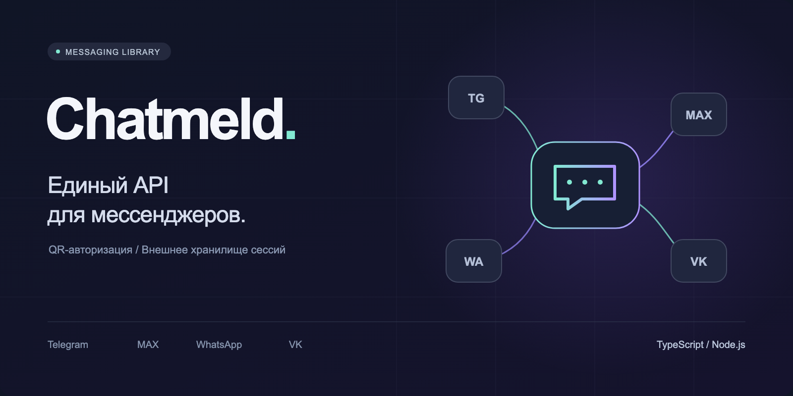

<p align="center">
	<a href="README.md"></a>
	
</p>

<p align="center">
  
</p>

<p align="center">
  <a href="https://github.com/aimuzov/chatmeld/actions/workflows/check.yml"></a>
  <a href="package.json"></a>
  <a href="src/index.ts"></a>
  
</p>

<h3 align="center">Единый API для личных аккаунтов мессенджеров</h3>

# Chatmeld

Библиотека для личных аккаунтов Telegram, MAX, WhatsApp и VK. Её подключают к
backend своего проекта. Она проводит QR-вход, восстанавливает соединения, возвращает
диалоги, отправляет текст и передаёт входящие сообщения.

Интерфейс чата, HTTP API, пользователи и хранение переписки остаются в проекте.
Сессии мессенджеров библиотека читает и обновляет через ваш `SessionStorage`. Файлы
сессий и собственную базу переписки она не создаёт.

## Установка

Нужен Node.js >=24. Пакет пока не опубликован в npm. Из каталога библиотеки соберите
архив:

```sh
npm ci
npm pack
```

В проекте-потребителе установите полученный файл:

```sh
npm install -E /path/to/chatmeld-0.1.0.tgz
```

Для VK нужен Chromium из Playwright. Установите его на том же сервере, где будет
работать библиотека:

```sh
npm exec playwright install chromium
```

Для MAX нужен Python >=3.12 с `maxapi-python==2.5.0`. Создайте отдельное
Python-окружение и передайте путь к его интерпретатору в `pythonCommand`. Файлы
`python/pyproject.toml` и `python/uv.lock` входят в архив пакета. Остальные
провайдеры не требуют Python. `tsx` потребителю не нужен.

## QR-вход из своего backend

```ts
import { createAdapter, type AuthEvent, type SessionStorage } from "chatmeld";

declare const storage: SessionStorage;
declare function publishAuthEvent(event: AuthEvent): Promise<void>;

const adapter = createAdapter({
  provider: "vk",
  accountId: "user-42-vk-main",
  storage,
});

const stop = new AbortController();
const login = adapter.authorize({
  signal: stop.signal,
  onEvent: publishAuthEvent,
});

function handleUserResponse(challengeId: string, value: string) {
  adapter.respondToChallenge({ challengeId, value });
}

await login;
```

Событие `qr` содержит строку `value` для построения QR. Новый QR заменяет
предыдущий. У Telegram также доступен `expiresAt`. Событие `challenge` содержит
`challengeId`, `kind` (`code` или `password`), `prompt` и, когда известно,
`pattern`. Событие `progress` содержит `message`.

QR, коды и пароли передавайте только владельцу подключения.

Метод `respondToChallenge` вызывается после получения соответствующего `challenge`.
В примере вызовы показаны рядом, но в веб-приложении это разные запросы: один
запускает вход, другой передаёт ответ пользователя. Вход длится не больше трёх
минут. `stop.abort()` отменяет его и закрывает ресурсы этого подключения.

Отменённый, чужой или уже обработанный `challengeId` возвращает ошибку. Неверный
формат ответа оставляет запрос активным: пользователь может исправить ввод.

Метод `authorize()` завершается только после успешного входа и сохранения сессии. Не
объявляйте вход успешным по исчезнувшему QR или отправленному коду. События
авторизации не содержат сохранённых токенов или ключей сессии.

## Хранение сессий

```ts
export interface SessionStorage {
  read(key: string): Promise<Uint8Array | undefined>;
  writeBatch(changes: readonly SessionChange[]): Promise<void>;
}

export type SessionChange =
  | { type: "set"; key: string; value: Uint8Array }
  | { type: "delete"; key: string };
```

Значение `undefined` означает, что записи нет. Ошибку БД нужно выбросить, а не
вернуть вместо неё пустую сессию. Метод `writeBatch` применяет весь набор атомарно и
разрешает Promise после надёжной записи. Для БД используйте транзакцию.

Библиотека упорядочивает записи одного подключения; WhatsApp обновляет ключи и после
авторизации, поэтому сохранять только итог входа недостаточно.

Создавайте отдельную область ключей для каждого сочетания пользователя, провайдера и
аккаунта. Формат значений принадлежит библиотеке и версионируется. Храните байты без
изменений. Выбор БД, шифрование и доступ к записям -- ваша сторона.

В нескольких backend-процессах назначайте одного владельца активного подключения к
аккаунту. Библиотека не берёт распределённую блокировку в вашей БД.

Для примеров и тестов экспортируется `MemorySessionStorage`. Содержимое исчезает при
завершении процесса; это не постоянное хранилище для сервера. Библиотека не
закрывает ваше хранилище и не владеет его пулом соединений.

## Подключение и сообщения

Для сохранённой сессии вызывайте `connect()`. Он восстанавливает соединение и не
запускает QR-вход автоматически. Отсутствующая сессия возвращает
`AdapterError` с кодом `AUTH_REQUIRED`.

```ts
import type { AdapterState, Message } from "chatmeld";

declare function publishState(state: AdapterState): void;
declare function persistIncoming(message: Message): Promise<void>;

adapter.onState(publishState);
adapter.onMessage(persistIncoming);

await adapter.connect();
const chats = await adapter.listChats();
await adapter.sendMessage(chats[0]!.id, "Привет!");
await adapter.disconnect();
```

Обе подписки возвращают функцию отписки. Обработчик сообщений может быть
асинхронным. Его ошибка и переполнение очереди завершают подключение с явной
ошибкой, а не теряют сообщения молча. Очередь ограничена сотней сообщений.

Вызов `disconnect()` закрывает соединение и завершает записи сессии; сессия остаётся
в вашем хранилище. Подключение можно восстановить тем же экземпляром. Одновременные
`connect()` и `authorize()` на одном экземпляре запрещены.

Для Telegram передайте `provider: "telegram"`, `apiId` и `apiHash` собственного
приложения. Для MAX используйте `provider: "max"` и при необходимости
`pythonCommand`. Для WhatsApp достаточно `provider: "whatsapp"`. Все варианты
требуют `accountId` и `storage`.

Сообщение содержит `provider`, `accountId`, `chatId`, `messageId`, `direction`,
`text`, `sentAt`, `attachments` и доступные сведения об отправителе. Идентификаторы
передаются строками. Для устранения дублей учитывайте провайдера, аккаунт, диалог и
идентификатор сообщения.

Подписка передаёт входящие сообщения; результат отправки своего сообщения сохраните
по ответу `sendMessage()`, который содержит `externalId`.

История, файлы вложений, реакции, прочтения, восстановление пропусков и собственный
outbox сюда не входят. Гарантии ровно одной доставки нет. Эти механизмы при
необходимости добавляет проект-потребитель.

## Ошибки

Публичный `AdapterError` содержит безопасный `message` и `code`. Основные коды:
`AUTH_REQUIRED`, `AUTH_CANCELLED`, `AUTH_TIMEOUT`, `INVALID_STATE`,
`INVALID_OPTIONS`, `INVALID_CHALLENGE`, `INVALID_RESPONSE`, `STORAGE_ERROR`,
`PROVIDER_ERROR`, `HANDLER_ERROR`, `QUEUE_OVERFLOW`.

При ошибке хранения библиотека останавливает соединение. Не продолжайте отправку с
неподтверждённым состоянием ключей. Код ошибки не заменяет проверку прав
пользователя в HTTP-маршрутах вашего проекта.

## Разработка

```sh
npm test
npm run setup:max
npm run test:max
npm run check
npm run test:package
npm pack
```

Тесты не входят в пользовательские аккаунты. Проверки SDK, хранилища, RPC, отмены и
QR дополняются отдельной проверкой собранного worker без `tsx`. Живой вход остаётся
отдельной проверкой с владельцем аккаунта.
