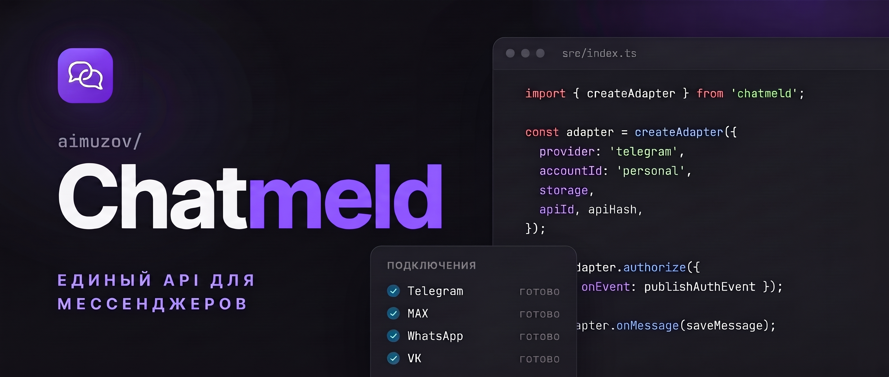

<p align="center">
	<a href="https://github.com/aimuzov/chatmeld/blob/main/README.md"></a>
	
</p>

<p align="center">
  
</p>

<p align="center">
  <a href="https://github.com/aimuzov/chatmeld/actions/workflows/check.yml"></a>
  <a href="https://github.com/aimuzov/chatmeld/blob/main/package.json"></a>
  <a href="https://github.com/aimuzov/chatmeld/blob/main/src/index.ts"></a>
  <a href="https://www.npmjs.com/package/@aimuzov/chatmeld"></a>
  <a href="https://github.com/aimuzov/chatmeld/releases"></a>
  
</p>

<h3 align="center">Единый API для личных аккаунтов мессенджеров</h3>

# Chatmeld

Библиотека для личных аккаунтов Telegram, MAX, WhatsApp, VK и Instagram. Её подключают к backend своего проекта: она проводит QR-вход, восстанавливает соединения, возвращает диалоги, отправляет текст и передаёт входящие сообщения.

Ваш проект предоставляет пользователей, интерфейс, HTTP API, базу переписки и хранилище сессий. Chatmeld управляет подключениями; собственной БД и сервера у библиотеки нет.

## Установка

Нужен Node.js >=24. Пакет содержит собранный ESM-код и декларации TypeScript; `tsx` потребителю не нужен.

```sh
npm install -E @aimuzov/chatmeld
```

### Параметры провайдеров

Для всех вариантов обязательны `accountId: string` и `storage: SessionStorage`. `accountId` задаёт ваш проект; это не токен и не ID пользователя мессенджера.

| `provider`    | Дополнительные параметры                                   | Окружение                             |
| ------------- | ---------------------------------------------------------- | ------------------------------------- |
| `"telegram"`  | `apiId: number`, `apiHash: string` собственного приложения | Node.js                               |
| `"max"`       | `pythonCommand?: string` -- путь к интерпретатору          | Python >=3.12, `maxapi-python==2.5.0` |
| `"whatsapp"`  | Нет                                                        | Node.js                               |
| `"vk"`        | Нет                                                        | Chromium из Playwright                |
| `"instagram"` | `username: string`, `pythonCommand?: string`               | Python >=3.12, `instagrapi==3.2.2`    |

Для VK установите Chromium на сервере приложения:

```sh
npm exec playwright install chromium
```

VK использует отдельный headless-браузер при входе и закрывает его после успеха, ошибки или отмены. Сообщения идут через API. MAX запускает отдельный Python-процесс; передайте интерпретатор с установленной зависимостью. В пакет входят `python/pyproject.toml` и `python/uv.lock`.

## Быстрый старт

Сохраните реализацию из раздела "Хранение сессий" в `sqlite-storage.ts`, а этот пример -- в `app.ts`. Соберите TypeScript как NodeNext/ESM и запустите полученный `app.js`. Пример восстанавливает сессию, выводит диалоги и закрывает соединение. Для первого входа нужен поток авторизации из следующего раздела.

```ts
import { AdapterError, createAdapter } from "@aimuzov/chatmeld";
import { DatabaseSync } from "node:sqlite";
import { sqliteSessionStorage } from "./sqlite-storage.js";

const db = new DatabaseSync("sessions.sqlite");
const userId = "user-42";
const accountId = "main";
const provider = "whatsapp";
const storage = sqliteSessionStorage(
  db,
  JSON.stringify([userId, provider, accountId]),
);
const adapter = createAdapter({ provider, accountId, storage });

const removeState = adapter.onState((state) => {
  if (state.state === "error") console.error(state.error);
});
const removeMessages = adapter.onMessage(async (message) => {
  console.log(message.messageId);
});

try {
  await adapter.connect();
  const chats = await adapter.listChats();
  console.log(chats);
} catch (error) {
  if (error instanceof AdapterError && error.code === "AUTH_REQUIRED") {
    console.log("Start authorization from your application");
  } else {
    throw error;
  }
} finally {
  await adapter.disconnect();
  removeMessages();
  removeState();
  db.close();
}
```

```sh
npm pkg set type=module
npm install -D -E typescript @types/node
npx tsc app.ts sqlite-storage.ts --module nodenext --target es2022 --types node --outDir dist
node dist/app.js
```

Для постоянного приёма сообщений оставьте экземпляр подключённым до остановки сервиса. Замените `console.log` в обработчике на надёжную запись в вашу БД.

## QR, подтверждение и владелец подключения

Это код слоя приложения, а не готовые HTTP-маршруты. `storageFor` возвращает постоянное хранилище нужного пользователя и аккаунта; `sendToUser` передаёт события его клиенту через ваш транспорт. Подставляйте `userId` из проверенной серверной сессии и проверяйте доступ к `accountId` в каждом запросе.

```ts
import type {
  AuthEvent,
  MessagingAdapter,
  SessionStorage,
} from "@aimuzov/chatmeld";
import { createAdapter } from "@aimuzov/chatmeld";

declare function storageFor(userId: string, accountId: string): SessionStorage;
declare function sendToUser(userId: string, event: AuthEvent): Promise<void>;

const connections = new Map<
  string,
  {
    adapter: MessagingAdapter;
    stop: AbortController;
  }
>();

function connectionKey(userId: string, accountId: string) {
  return JSON.stringify([userId, "vk", accountId]);
}

export async function authorize(userId: string, accountId: string) {
  const key = connectionKey(userId, accountId);
  if (connections.has(key)) throw new Error("Connection already active");
  const adapter = createAdapter({
    provider: "vk",
    accountId,
    storage: storageFor(userId, accountId),
  });
  const stop = new AbortController();
  connections.set(key, { adapter, stop });
  try {
    await adapter.authorize({
      signal: stop.signal,
      onEvent: (event) => sendToUser(userId, event),
    });
    return adapter;
  } catch (error) {
    await adapter.disconnect();
    if (connections.get(key)?.adapter === adapter) connections.delete(key);
    throw error;
  }
}

export function respond(
  userId: string,
  accountId: string,
  response: { challengeId: string; value: string },
) {
  const connection = connections.get(connectionKey(userId, accountId));
  if (!connection) throw new Error("Connection not found");
  connection.adapter.respondToChallenge(response);
}

export async function close(userId: string, accountId: string) {
  const key = connectionKey(userId, accountId);
  const connection = connections.get(key);
  if (!connection) return;
  connection.stop.abort();
  await connection.adapter.disconnect();
  if (connections.get(key)?.adapter === connection.adapter)
    connections.delete(key);
}
```

Первый запрос запускает `authorize()`. Клиент получает `qr`, строит изображение из `value` и заменяет его при новом событии. Если пришёл `challenge`, клиент показывает `prompt` и передаёт именно полученный `challengeId` вместе с введённым `value` во второй запрос, который вызывает `respond()`.

Оба запроса должны попасть в один backend-процесс и тот же экземпляр адаптера. Не создавайте новый адаптер для ответа. Успешный `authorize()` оставляет соединение активным; используйте возвращённый адаптер для диалогов, отправки и подписок. `close()` вызывается отдельно при завершении работы аккаунта.

| Событие     | Поля                                                                            |
| ----------- | ------------------------------------------------------------------------------- |
| `qr`        | `value: string`, необязательный `expiresAt: string`                             |
| `challenge` | `challengeId`, `kind: "code" \| "password"`, `prompt`, необязательный `pattern` |
| `progress`  | `message: string`                                                               |

Вход ограничен тремя минутами. `AbortSignal` отменяет вход; успешным он считается только после завершения Promise и записи сессии. Коды VK и пароль 2FA Telegram проходят через один API подтверждений. QR, ответы и пароли передавайте только владельцу и не сохраняйте в логах. События не содержат сохранённых токенов сессии.

Карта `connections` существует в памяти процесса. После перезапуска пропадут экземпляры и незавершённые запросы, но не сохранённые сессии. Восстановите подключения через `connect()`; незавершённый вход запустите заново. В production добавьте управление жизненным циклом, маршрутизацию к владельцу подключения и очистку по завершении работы.

## API

| API                                          | Результат и поведение                                                                                                                                                                   |
| -------------------------------------------- | --------------------------------------------------------------------------------------------------------------------------------------------------------------------------------------- |
| `createAdapter(options)`                     | Возвращает `MessagingAdapter`; синхронно проверяет параметры. Подключение ещё не запускается.                                                                                           |
| `adapter.provider`, `adapter.accountId`      | Доступные для чтения провайдер и заданный вашим проектом идентификатор аккаунта.                                                                                                        |
| `connect({ signal? }?)`                      | `Promise<void>`; восстанавливает сохранённую сессию без интерактивного входа.                                                                                                           |
| `authorize({ onEvent, signal? })`            | `Promise<void>`; QR-вход, возможные запросы подтверждения, запись сессии и подключение.                                                                                                 |
| `respondToChallenge({ challengeId, value })` | `void`; отвечает на активный запрос этого экземпляра; может синхронно выбросить ошибку.                                                                                                 |
| `listChats()`                                | `Promise<Chat[]>`; каждый диалог содержит строки `id` и `title`. Нужно подключение.                                                                                                     |
| `getAvatar({ type, id })`                    | `Promise<Avatar \| undefined>`; аватарка диалога или пользователя: байты и MIME-тип.                                                                                                    |
| `sendMedia(chatId, media)`                   | `Promise<{ externalId: string }>`; фото, видео или аудио, до 20 MiB.                                                                                                                    |
| `downloadMedia(reference)`                   | `Promise<MediaFile>`; серверный reference вложения, до 20 MiB.                                                                                                                          |
| `listMessages?(chatId, { limit? }?)`         | `Promise<Message[]>`; последние сообщения Telegram/VK/Instagram от новых к старым. Лимит по умолчанию 100, допустимы целые 1..100. Для WhatsApp/MAX возвращает `[]`. Нужно подключение. |
| `sendMessage(chatId, text)`                  | `Promise<{ externalId: string }>`; отправляет непустой текст в диалог со строковым ID. Нужно подключение.                                                                               |
| `onMessage(handler)`                         | Подписка на входящие; обработчик возвращает `void` или `Promise<void>`. Возвращает функцию отписки.                                                                                     |
| `onState(handler)`                           | Подписка на будущие смены состояния; обработчик синхронный. Возвращает функцию отписки.                                                                                                 |
| `disconnect()`                               | `Promise<void>`; закрывает ресурсы и завершает записи сессии, сохраняя сессию.                                                                                                          |

Не запускайте несколько `connect()`/`authorize()` на одном экземпляре. Дождитесь `disconnect()` перед новым запуском. Закрытие во время входа отменяет его; повторные вызовы `disconnect()` безопасны. Закрытие не удаляет сессию и не закрывает вашу БД.

Состояния: `connecting`, `authorizing`, `connected`, `disconnected` и `error`. Тип `AdapterState` также допускает `idle`; подписка сообщает будущие изменения, без немедленного снимка. В состоянии `error` поле `error` содержит ошибку. Обработчик состояния синхронный: не передавайте ему `async`-функцию.

Подписывайтесь до подключения. Сообщения без подписчиков не накапливаются. Асинхронные обработчики выполняются по очереди; лимит очереди -- 100 сообщений, включая обрабатываемое. Ошибка обработчика и переполнение закрывают подключение с `HANDLER_ERROR` или `QUEUE_OVERFLOW`. Обработка не заменяет вашу очередь и подтверждённую запись.

## Диалоги и сообщения

После успешного `connect()` или `authorize()` можно выбирать диалог и отправлять текст. В примере `selectedChatId` приходит от вашего клиента, а `persistOutgoing` сохраняет отправку в вашу БД.

```ts
const chats = await adapter.listChats();
const chat = chats.find((item) => item.id === selectedChatId);
if (!chat) throw new Error("Chat not found");
const sent = await adapter.sendMessage(chat.id, "Hello!");
await persistOutgoing({
  provider: adapter.provider,
  accountId: adapter.accountId,
  chatId: chat.id,
  messageId: sent.externalId,
  text: "Hello!",
});
```

Подписка передаёт входящие сообщения. Исходящее отображайте и сохраняйте по результату `sendMessage()` с `externalId`: собственного echo в `onMessage` ждать не нужно.

Пример `Message`:

```json
{
  "provider": "whatsapp",
  "accountId": "main",
  "chatId": "120363000000000000@g.us",
  "messageId": "ABC123",
  "senderId": "15551234567@s.whatsapp.net",
  "displayName": "Alice",
  "direction": "incoming",
  "text": "Hello!",
  "sentAt": "2026-11-03T10:00:00.000Z",
  "attachments": []
}
```

Все ID -- строки. Поля `senderId`, `displayName`, `username` необязательны; `direction` имеет тип `"incoming" | "outgoing"`. `sentAt` -- строка времени, `attachments` содержит метаданные и серверные references для скачивания; байты файлов получаются отдельно. Для устранения дублей используйте сочетание провайдера, аккаунта, диалога и ID сообщения.

### Последние сообщения

Telegram, VK и Instagram возвращают последние сообщения от новых к старым. `listMessages` необязателен в публичном интерфейсе: используйте optional chaining для совместимости с реализациями без метода. Пустой массив для WhatsApp/MAX не означает отсутствие переписки; эти провайдеры передают входящие после подключения.

```ts
const recent =
  (await adapter.listMessages?.(selectedChatId, { limit: 50 })) ?? [];
for (const message of recent) {
  await persistIncoming(message);
}
```

Метод `listHistoryPage(chatId, { limit, cursor })` загружает историю страницами у всех пяти провайдеров. В первом запросе опустите `cursor`, затем передавайте `nextCursor` из ответа, пока курсор возвращается. WhatsApp запрашивает более ранние сообщения после получения первого сообщения от связанного устройства.

`persistIncoming` сохраняет сообщение в вашей БД. Поле `direction` позволяет различать входящие и исходящие сообщения. Постоянная история остаётся в вашем проекте.

Для Telegram укажите SOCKS5 URL с портом в `CHATMELD_TELEGRAM_SOCKS`. Для WebSocket WhatsApp задайте `HTTPS_PROXY`. Прокси WhatsApp требует Node.js 24.5 или новее.

## Instagram

Установите Python >=3.12 с `instagrapi==3.2.2` и передайте путь интерпретатора в `pythonCommand`. В репозитории `npm run setup:instagram` создаёт окружение с дополнительной зависимостью Instagram.

Username задаётся без `@`. Передайте `storage` своего пользователя. Пароль и коды подтверждения проходят через существующие `authorize()` / `respondToChallenge()`. QR-вход для Instagram не реализован. Пароль не сохраняется в сессии.

```ts
const instagram = createAdapter({
  provider: "instagram",
  accountId: "personal",
  username: "your_username",
  pythonCommand: "/app/.venv/bin/python",
  storage,
});
```

Используется неофициальный API. Некоторые проверки требуют подтверждения в приложении Instagram и повторного входа. Новые сообщения опрашиваются раз в 15 секунд: последние 20 диалогов, до 20 сообщений в каждом. Это best effort; при большом потоке возможны пропуски.

## Аватарки

`getAvatar({ type: "chat" | "user", id })` возвращает `{ data: Uint8Array, mimeType }` либо `undefined`, если фотографии нет. Метод поддерживают все пять провайдеров. Фото скачиваются по запросу, лимит 256 KiB; собственного хранилища аватарок нет.

Вызывайте метод на сервере после проверки принадлежности аккаунта. Ваш проект отдаёт байты через свой HTTP-маршрут и управляет кешированием. Групповые фотографии Instagram недоступны в SDK и возвращают `undefined`.

```ts
import type { AvatarTarget, MessagingAdapter } from "@aimuzov/chatmeld";

export async function avatarResponse(
  adapter: MessagingAdapter,
  target: AvatarTarget,
) {
  const avatar = await adapter.getAvatar(target);
  return avatar
    ? new Response(new Uint8Array(avatar.data), {
        headers: { "Content-Type": avatar.mimeType },
      })
    : new Response(null, { status: 404 });
}
```

## Фото, видео и аудио

`sendMedia(chatId, { kind, data, mimeType, fileName?, caption? })` отправляет один файл и возвращает `{ externalId }`. `kind`: `"photo"`, `"video"` или `"audio"`; `data`: `Uint8Array`. Лимит отправки и скачивания: 20 MiB на файл. Chatmeld не конвертирует кодеки и не хранит файлы.

Вложения входящих сообщений и истории получают `reference` для скачиваемого медиа, а также доступные `mimeType`, `fileName` и `size`. Передайте ссылку в `downloadMedia(reference)`: результат `{ data, mimeType, fileName? }`. В примере `adapter`, `selectedChatId` и `message` принадлежат вашему приложению.

```ts
import { readFile } from "node:fs/promises";

const sent = await adapter.sendMedia(selectedChatId, {
  kind: "photo",
  data: new Uint8Array(await readFile("photo.jpg")),
  mimeType: "image/jpeg",
  fileName: "photo.jpg",
});

for (const attachment of message.attachments) {
  if (!attachment.reference) continue;
  const file = await adapter.downloadMedia(attachment.reference);
  console.log(file.mimeType, file.data.byteLength);
}
```

Сохраняйте references на сервере вместе с сообщениями и проверяйте владельца перед скачиванием. Для WhatsApp reference содержит сведения для расшифровки медиа; не публикуйте его в логах или клиентском API. Скачанные файлы сохраняет ваш проект. Собственной БД сообщений у библиотеки нет.

| Провайдер | Отправка и ограничения скачивания                                                                                         |
| --------- | ------------------------------------------------------------------------------------------------------------------------- |
| Telegram  | Фото, видео и аудиофайлы, подписи поддерживаются. Потоковое видео зависит от формата.                                     |
| MAX       | Фото и видео; обычное аудио отправляется файлом. Для скачивания провайдер должен вернуть URL.                             |
| WhatsApp  | Фото, видео и аудио через SDK с шифрованием и расшифровкой. Подпись к аудио не поддерживается.                            |
| VK        | Фото, видео и аудио в виде документа, подписи поддерживаются. Внешний видеоплеер без прямого URL файла не скачивается.    |
| Instagram | Фото JPEG/PNG/WebP, видео MP4 и аудио AAC в M4A/MP4. Без подписей к медиа. Общие посты и ссылки не скачиваются как файлы. |

Неподдерживаемая операция возвращает `UNSUPPORTED_OPERATION` без повторной отправки и отключения соединения. При сетевой ошибке решение о повторе принимает приложение. Временные файлы загрузки Instagram удаляются после операции.

## Хранение сессий

Полная реализация для встроенного `node:sqlite` из [examples/sqlite-storage.ts](https://github.com/aimuzov/chatmeld/blob/main/examples/sqlite-storage.ts):

```ts
import { DatabaseSync } from "node:sqlite";
import type { SessionStorage } from "@aimuzov/chatmeld";

export function sqliteSessionStorage(
  db: DatabaseSync,
  scope: string,
): SessionStorage {
  db.exec(`CREATE TABLE IF NOT EXISTS chatmeld_sessions (
    scope TEXT NOT NULL,
    key TEXT NOT NULL,
    value BLOB NOT NULL,
    PRIMARY KEY (scope, key)
  )`);
  const read = db.prepare(
    "SELECT value FROM chatmeld_sessions WHERE scope = ? AND key = ?",
  );
  const write = db.prepare(
    "INSERT INTO chatmeld_sessions (scope, key, value) VALUES (?, ?, ?) ON CONFLICT(scope, key) DO UPDATE SET value = excluded.value",
  );
  const remove = db.prepare(
    "DELETE FROM chatmeld_sessions WHERE scope = ? AND key = ?",
  );
  return {
    async read(key) {
      const row = read.get(scope, key);
      return row ? new Uint8Array(row.value as Uint8Array) : undefined;
    },
    async writeBatch(changes) {
      db.exec("BEGIN IMMEDIATE");
      try {
        for (const change of changes) {
          if (change.type === "set") write.run(scope, change.key, change.value);
          else remove.run(scope, change.key);
        }
        db.exec("COMMIT");
      } catch (error) {
        db.exec("ROLLBACK");
        throw error;
      }
    },
  };
}
```

Область `JSON.stringify([userId, provider, accountId])` изолирует ключи пользователей, провайдеров и аккаунтов без неоднозначности разделителей. Ключи и версионированный формат значений принадлежат Chatmeld; не переименовывайте ключи и не разбирайте их содержимое.

`read` возвращает `undefined` только при отсутствии записи. Сбой БД должен выбрасывать ошибку. Значения храните как BLOB, без текстового кодирования; возвращайте неизменённые байты `Uint8Array`. Шифрование, резервные копии и права доступа обеспечивает ваш проект.

`writeBatch` должен атомарно применить весь набор и завершиться после commit. При ошибке -- rollback и выброшенная ошибка. Не запускайте пересекающиеся транзакции на этом соединении. Библиотека упорядочивает записи одного адаптера, но не координирует все ваши экземпляры и процессы.

WhatsApp обновляет параметры сессии и ключи во время работы, после QR-входа. Хранилище должно оставаться доступным весь срок подключения. При ошибке хранения адаптер останавливается: продолжать работу с несохранёнными ключами нельзя.

Назначайте одного активного владельца аккаунта. При нескольких процессах распределённый lease, продление и передача владения -- ответственность потребителя. Встроенной блокировки нет. Жизненный цикл SQLite-соединения или пула также принадлежит вашему приложению.

`MemorySessionStorage` экспортируется для тестов: `new MemorySessionStorage()`. Его содержимое исчезает вместе с процессом; повторный QR-вход не заменяет постоянное хранилище.

## Ошибки

Методы возвращают `AdapterError` с безопасным `message` и машинным `code`. Проверяйте класс через `instanceof AdapterError`, а поведение выбирайте по коду. Асинхронные сбои активного подключения также приходят в `onState` как `{ state: "error", error }`.

При передаче состояния клиенту сериализуйте ошибку явно: `JSON.stringify(new Error())` не включает `message`. Например:

```ts
declare function publishState(payload: string): void;

const removeState = adapter.onState((state) => {
  const payload =
    state.state === "error"
      ? {
          state: "error",
          error: {
            code:
              state.error instanceof AdapterError
                ? state.error.code
                : "PROVIDER_ERROR",
            message: state.error.message,
          },
        }
      : state;
  publishState(JSON.stringify(payload));
});
```

| Код                     | Значение                                                                                 |
| ----------------------- | ---------------------------------------------------------------------------------------- |
| `INVALID_OPTIONS`       | Неверные параметры, отсутствующий обработчик или пустое сообщение.                       |
| `INVALID_STATE`         | Подключение уже активно, запускается или закрывается.                                    |
| `AUTH_REQUIRED`         | Нет пригодной сессии или активного подключения.                                          |
| `AUTH_CANCELLED`        | Операция отменена сигналом или закрытием.                                                |
| `AUTH_TIMEOUT`          | Вход занял больше трёх минут.                                                            |
| `INVALID_CHALLENGE`     | Неизвестный, чужой, истёкший или уже обработанный запрос.                                |
| `INVALID_RESPONSE`      | Пустой ответ, больше 4096 символов или несовпадение с pattern. Запрос остаётся активным. |
| `STORAGE_ERROR`         | Ошибка чтения или записи сессии.                                                         |
| `PROVIDER_ERROR`        | Ошибка провайдера, включая таймаут подключения.                                          |
| `HANDLER_ERROR`         | Ошибка обработчика сообщений, состояния или событий входа.                               |
| `QUEUE_OVERFLOW`        | Очередь входящих достигла лимита в 100 сообщений.                                        |
| `UNSUPPORTED_OPERATION` | Неподдерживаемый формат, операция или недоступное вложение; соединение остаётся рабочим. |
| `DISCONNECTED`          | Подключение провайдера завершилось.                                                      |

## Подтверждения доставки

Подписка: `adapter.onReceipt?.(handler)`. Обработчик может быть асинхронным; возвращённая функция отменяет подписку. Событие содержит `provider`, `accountId`, `chatId` и статус `delivered` или `read`. Оно указывает точные `messageIds`, числовую границу `throughMessageId` или временную границу `throughSentAt`. Применяйте границы только к исходящим сообщениям этого аккаунта и чата. Сохраняйте подтверждение, даже если сообщение ещё не записано, и не откатывайте прочтение к доставке.

В личных диалогах WhatsApp сообщает доставку и прочтение, Telegram/VK/MAX -- прочтение. В Telegram нет отдельного статуса доставки на устройство. Подтверждения групп не передаются: событие одного участника не подтверждает всю группу. Это события работающего подключения, без восстановления подтверждений, пропущенных при отключении. MAX возвращает серверный `sentAt` в результате отправки для сопоставления с отметкой прочтения.

## Границы

Chatmeld читает последние сообщения Telegram/VK/Instagram, скачивает поддерживаемые медиа и отдаёт аватарки. История и файлы хранятся в вашем проекте. Реакции, полная синхронизация, ровно одна доставка и постоянный outbox не реализованы. Решение о повторе неопределённой отправки принимает приложение.

## Разработка и выпуск

```sh
git clone https://github.com/aimuzov/chatmeld.git
cd chatmeld
npm ci
npm run setup:max
npm run setup:instagram
npm run setup:vk-qr
npm run check
npm test
npm run test:max
npm run test:package
npm pack
```

Архив версии 0.1.0 называется `aimuzov-chatmeld-0.1.0.tgz`:

```sh
npm install -E /path/to/aimuzov-chatmeld-0.1.0.tgz
```

Тесты проверяют хранилище, подтверждения, отмену, SDK, RPC и собранные workers без входа в реальные аккаунты. Проверка живого входа проводится отдельно с владельцем аккаунта.

Выпуск настроен через семейный reusable workflow `aimuzov/.github/.github/workflows/release.yml@v1`: Release Please готовит PR версии и GitHub Release. Публикация npm использует `aimuzov/infra-mcp-kit/publish@v3` и environment `npm`.

Настройте trusted publisher через OIDC либо repository secret `NPM_TOKEN` с правом публикации, затем включите `vars.NPM_PUBLISH=true`. Для привязки OIDC пакет уже должен существовать. С токеном тот же workflow может опубликовать первую версию.

Успешную публикацию проверяйте по результату release job и странице пакета.
